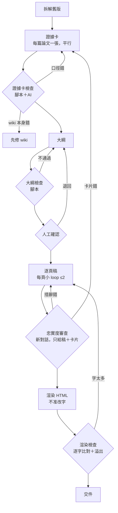

# AI 在股市分析上的應用與問題：LLM Wiki × 教學 HTML 簡報

第十週作業：用 LLM Wiki 做一份教學 HTML 簡報，並說明 loop／graph 的設計。

## 1. LLM Wiki 主題與簡介

主題是 **AI 在股市分析上的應用與問題**。依照 Karpathy 的 LLM Wiki 架構，採「先討論、後生成」的方式建立：先讓 AI 訪談需求，確認後才產生 `AGENTS.md` 和資料夾。目前已 ingest 5 篇論文：

| 論文 | 角色 |
| :-- | :-- |
| Fama (1970) *Efficient Capital Markets*, JF | 理論起點：效率市場 |
| Gu, Kelly & Xiu (2020) *Empirical Asset Pricing via Machine Learning*, RFS | 數值型機器學習 |
| Fischer & Krauss (2018) *Deep Learning with LSTM Networks*, EJOR | 深度學習 |
| Lopez-Lira & Tang (2026) *Can ChatGPT Forecast Stock Price Movements?*, JFE | 大語言模型 |
| Barber, Lee, Liu & Odean (2009) *Just How Much Do Individual Investors Lose by Trading?*, RFS | 台股實證 |

## 2. LLM Wiki 成果

- 規範手冊：[`AGENTS.md`](AGENTS.md)
- 索引：[`index.md`](index.md)
- 操作日誌：[`log.md`](log.md)，記錄每次 ingest、lint 與修正
- 知識頁：[`wiki/`](wiki/)，分為 literature、factors、behavior、methodologies、syntheses

（`raw/` 裡的原始論文 PDF 涉及版權，沒有上傳。）

## 3. 教學 HTML 簡報

- **Graph 版（最終版）**：[`docs/index.html`](docs/index.html)，開啟 GitHub Pages 後可直接瀏覽
- Loop 版（對照用）：[`output/deck.html`](output/deck.html)

## 4. Loop／Graph 流程

### Loop 版（先做）
規格見 [`slide-loop/SKILL.md`](slide-loop/SKILL.md)：產出 → 程式檢查 → AI 審查（新對話） → 只修報告列出的問題，最多 3 輪。

### Graph 版（最終）

| 關卡 | 只能看 | 怎麼檢查 |
| :-- | :-- | :-- |
| 證據卡 | 單一篇 wiki 頁 | 腳本：原句與數字都要逐字找得到；AI：口徑和但書有沒有漏 |
| 大綱 | 全部卡片 | 腳本：8–15 頁、每篇論文都用到、術語先定義後使用 |
| 逐頁稿 | 該頁大綱＋對應卡片 | 腳本：每行都標了卡片、數字在卡片裡；AI：語氣與口徑 |
| 渲染 | 已通過的稿 | 腳本：HTML 文字與稿逐字一致、三種尺寸都不溢出 |

**為什麼這樣設計：**loop 版的數字每一輪都對，錯都錯在數字旁邊的說法，而且到最後審查才被抓到。所以 graph 版把口徑寫進證據卡，讓檢查往前移；錯在哪一關，就只退回哪一關。

檢查腳本：[`output/graph/scripts/`](output/graph/scripts/)

## 5. 實際執行與檢查紀錄

- **Graph 版**：[`output/graph/report.md`](output/graph/report.md)，記錄每一關的通過、退回次數與原因
- Loop 版：[`output/report.md`](output/report.md)，第 0–3 輪
- 中間產物：[證據卡](output/graph/cards/)、[大綱](output/graph/outline.md)、[逐頁稿](output/graph/drafts/)

## 6. 反思

最常出錯的節點是「證據卡」和「逐頁稿」的口徑。數字本身都對，錯在數字旁邊的說法：把 10 年累積寫成每年、月度與年化混用、把理論或作者推測寫成事實。loop 版要到最後審查才抓到這些錯，所以 graph 版把檢查往前移到證據卡：每個數字先記下原句、口徑與類型，逐頁稿只能引用卡片，渲染時不准改字。此外，修正本身也會帶進新錯誤，所以每次修完都要重新審查。
